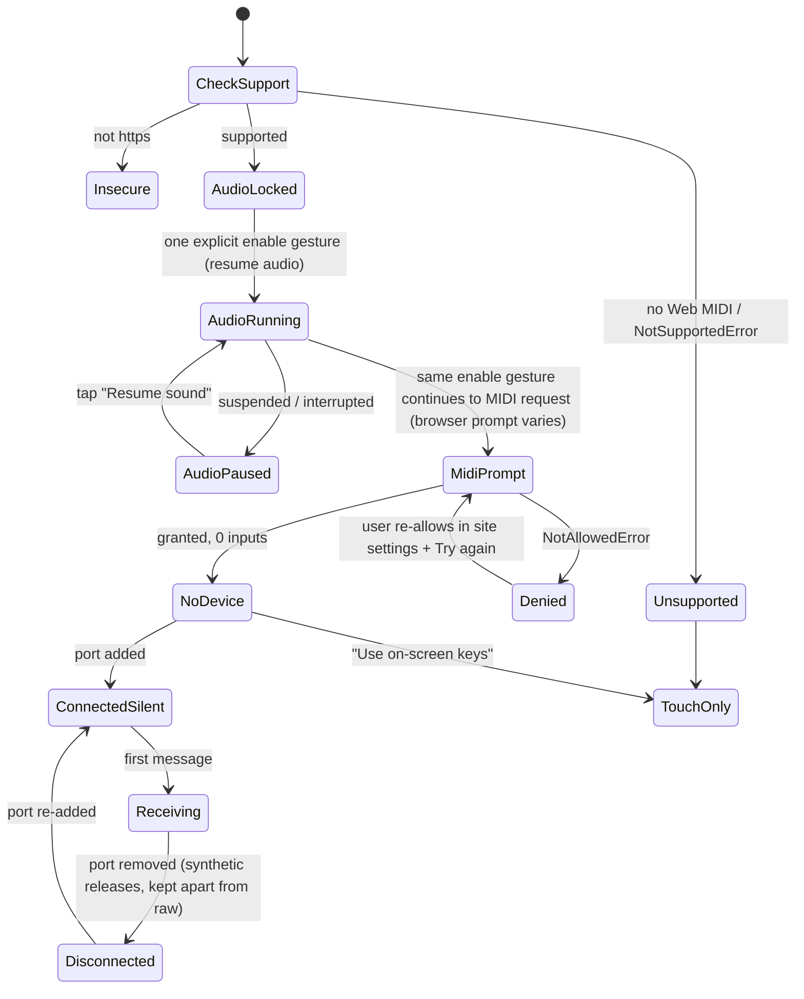
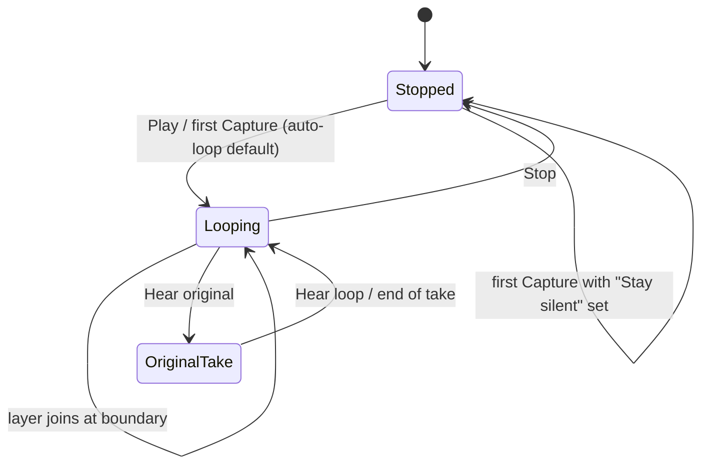
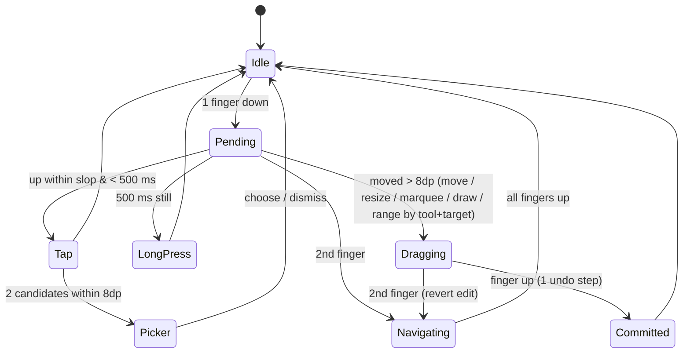
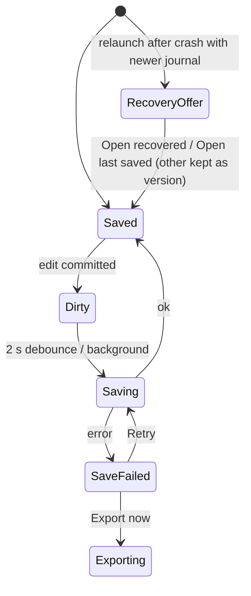
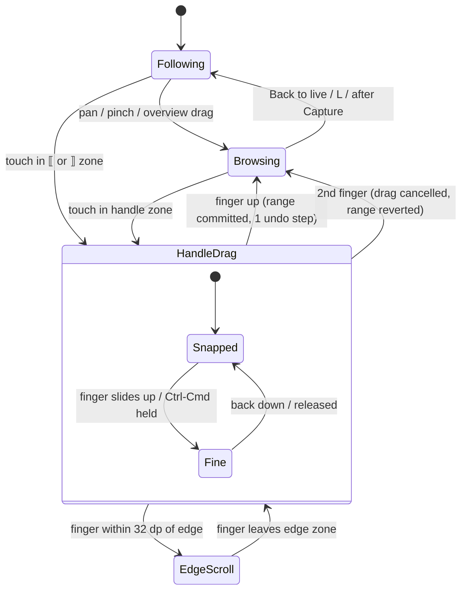
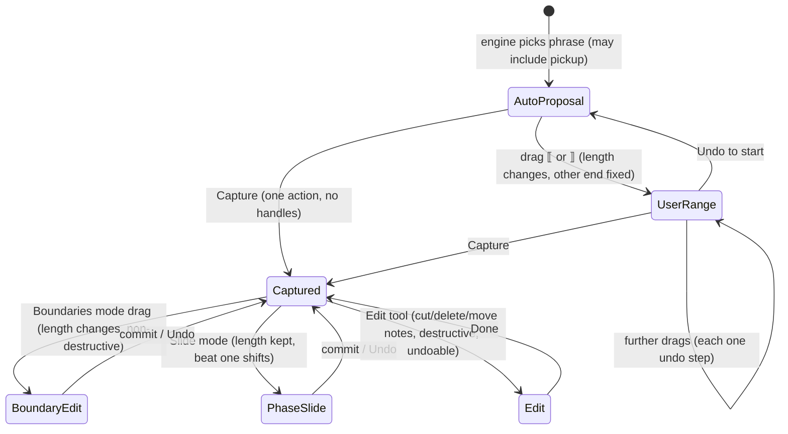

# Blocks — UI state machines (PROPOSED rev 2, mermaid)
Timers and limits are proposals pending measurement.

## Readiness (web; native skips Permission/Audio-gesture states)


## Capture lifecycle (rev 2 — lead decisions A1, A2, A4, A6)

```mermaid
stateDiagram-v2
  [*] --> Listening
  Listening --> Listening: events appended (age eviction past ~120 s is normal)
  Listening --> Overloaded: event/byte cap hit
  Overloaded --> Listening: gap recorded + flagged
  Listening --> DeliveryUncertain: tab hidden / app background
  DeliveryUncertain --> Listening: foreground again (gap flagged if any)
  Listening --> NothingToCapture: Capture, empty history
  NothingToCapture --> Listening
  Listening --> SlotsFull: Capture, no empty layer
  SlotsFull --> Listening: Cancel
  SlotsFull --> Selecting: explicit choice (new / replace / take only)
  Listening --> Inferring: Capture, no sketch tempo yet
  Listening --> Selecting: Capture, tempo exists (locked)
  Inferring --> Reviewing: pulse found (auto-loop)
  Inferring --> NoPulse: no steady pulse
  NoPulse --> Reviewing: keep free-time loop / Set BPM
  Selecting --> QueuedJoin: bounded history already played; synthetic releases for held notes
  QueuedJoin --> Reviewing: next loop boundary
  Reviewing --> Reviewing: length / beat one / half-double-manual / original take
  Reviewing --> Kept: Keep / dismiss / play on / Capture again
  Reviewing --> Discarded: Discard
  Discarded --> Kept: Undo
  Kept --> Listening
  Discarded --> Listening
```


## Transport


## Piano-roll pointer


## Save / recovery


## Take history view: follow / pan / range (rev 3.2, PROPOSED)


## Capture range proposal (rev 3.2)

Free time: AutoProposal and UserRange snap to note onsets only and never create bars. Held notes across the end are clipped for playback only (synthetic release, raw kept); pickups wrap to the beat before each repeat (PROPOSED behaviour, not an engine contract; "first pass only" is open, spec OQ-1).

## Appearance (rev 3.2)
```mermaid
stateDiagram-v2
  [*] --> System: first run (default)
  System --> Light: choose Light
  System --> Dark: choose Dark
  Light --> System: choose System
  Dark --> System: choose System
  Light --> Dark
  Dark --> Light
  note right of System: follows OS/browser live; every change re-themes instantly without touching audio, transport or MIDI; choice persisted on device
```
